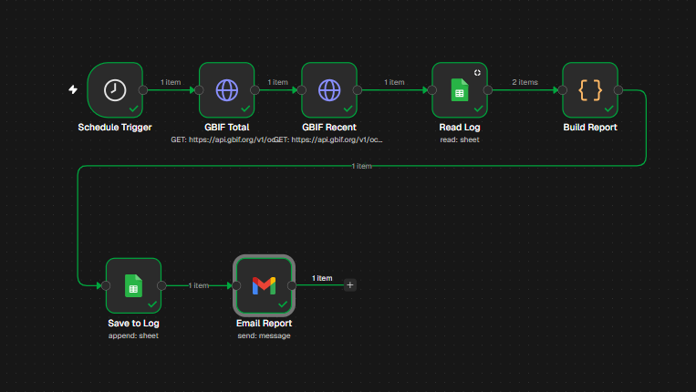
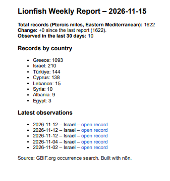
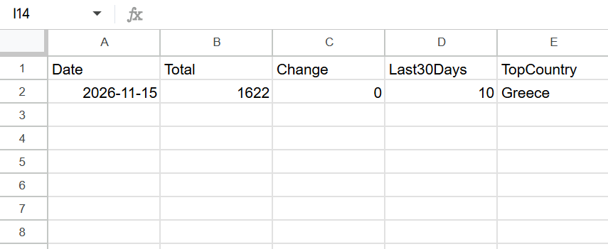

# Lionfish Weekly Report (n8n workflow)

A small n8n workflow that checks an open biodiversity database every Monday and emails me a short report on lionfish (*Pterois miles*) records in the Eastern Mediterranean.

I follow this data for a personal research project, so I built this to stop checking the website by hand.



## What it does

Every Monday at 09:00 the workflow:

1. asks the [GBIF](https://www.gbif.org) open data API for the total number of lionfish records in the Eastern Mediterranean, split by country;
2. asks GBIF for the observations made in the last 30 days;
3. reads last week's total from a Google Sheet;
4. works out the change since the last report and picks the five latest observations;
5. adds a new row to the Google Sheet (date, total, change, last 30 days, top country);
6. sends the report by email.

Because a new row is saved every week, the sheet slowly becomes a small dataset of how the record count grows over time.

## The seven steps

| # | Node | Type | Job |
|---|---|---|---|
| 1 | Schedule Trigger | Schedule | Runs every Monday at 09:00 |
| 2 | GBIF Total | HTTP Request | Total record count and counts by country |
| 3 | GBIF Recent | HTTP Request | Observations from the last 30 days |
| 4 | Read Log | Google Sheets | Reads earlier rows to find last week's total |
| 5 | Build Report | Code | Calculates the change and builds the email |
| 6 | Save to Log | Google Sheets | Appends this week's numbers |
| 7 | Email Report | Gmail | Sends the report |

## Example

The email:



The log sheet:



## Tools

- [n8n](https://n8n.io) (cloud)
- GBIF occurrence search API (no key needed)
- Google Sheets
- Gmail

## How to use it

1. Create a Google Sheet with these five headers in the first row: `Date`, `Total`, `Change`, `Last30Days`, `TopCountry`.
2. In n8n, create a new workflow and choose **Import from file**, then select `workflow.json`.
3. Open the two Google Sheets nodes (**Read Log**, **Save to Log**), connect your Google account and select your sheet. Replace `YOUR_SHEET_ID` and the tab name.
4. Open **Email Report**, connect your Gmail account and replace `your-email@example.com`.
5. Run the workflow once to test it, then publish it.

No passwords or keys are stored in `workflow.json`. Each user connects their own accounts inside n8n.

## Search area

Records are limited to this box: longitude 19°E to 37°E, latitude 30°N to 42°N.

```
POLYGON((19 30,37 30,37 42,19 42,19 30))
```

To follow another species or region, change `scientificName` and `geometry` in the two GBIF nodes.

## Limits

- The numbers are raw GBIF counts. Duplicates and uncertain records are not removed, so this is a monitoring tool, not a cleaned dataset.
- GBIF receives new records in batches, so the weekly change is often zero and sometimes jumps.
- Only *Pterois miles* is counted.

## Data source

GBIF.org, occurrence search, <https://www.gbif.org/occurrence/search>. Individual records keep the licence of their original dataset; this workflow only shows counts and links to the records.

## Notes

I designed the flow, built it in n8n and tested it. The JavaScript in the Code node was written with the help of an AI assistant.
